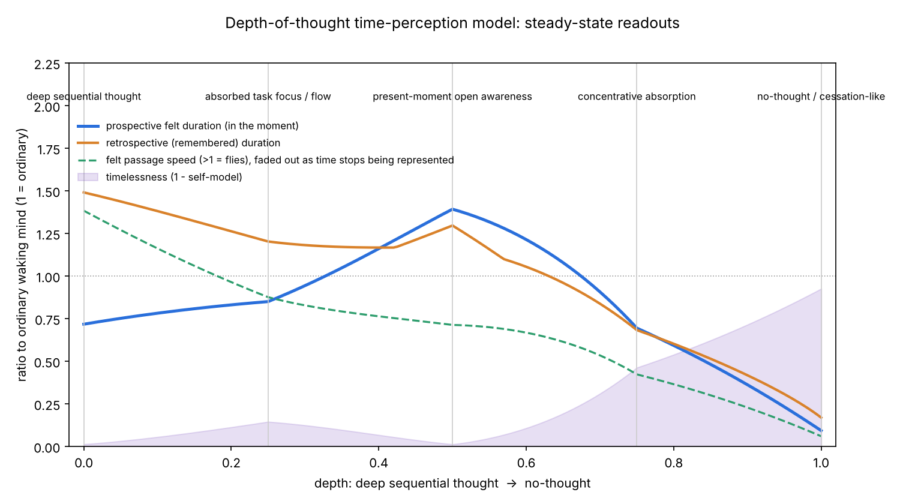

# elemental_discovery

## Depth of thought and the experience of time

A research deep dive plus a runnable computational model of how modes of thinking change
how time is experienced. The modes covered are sequential reasoning, authentic introspection,
meditation (focused, open, nondual), yoga, tai chi, qigong, Brazilian jiu-jitsu and parkour.
The model runs along a continuum from **deep thought to no thought**.

**Headline:** as discursive thought falls away while attention stays gathered, time first
**flies** (the attentional gate is closed by content), then **slows** (present-moment and
interoceptive awareness open the gate and speed the body clock), then **disappears** (the
self that reads the clock dissolves). These are three different phenomena, not one speed dial.

- Research write-up: [`docs/time_perception_deep_dive.md`](docs/time_perception_deep_dive.md)
- Model code: [`depthtime/`](depthtime/)
- Figures: [`figures/`](figures/) · Result tables: [`results/`](results/)



## Quick start

```bash
pip install -r requirements.txt
python -m depthtime sweep                         # steady-state curve along the depth axis
python -m depthtime session bjj --who expert      # one practice, one archetype
python -m depthtime report --runs 40              # all tables + figures
python -m depthtime fit examples/sample_sessions.csv   # fit the model to one person's data
python -m pytest -q
```

## Using it in code

```python
from depthtime import Individual, readout, state_at_depth, simulate_session

me = Individual(name="me", experience=0.4, interoception=1.2, mind_wandering=1.0)
print(readout(state_at_depth(0.5), me))           # present-moment awareness, steady state
print(simulate_session("tai_chi", me, seed=1).row())
```
