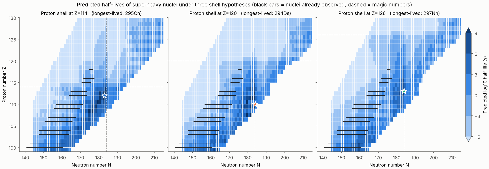
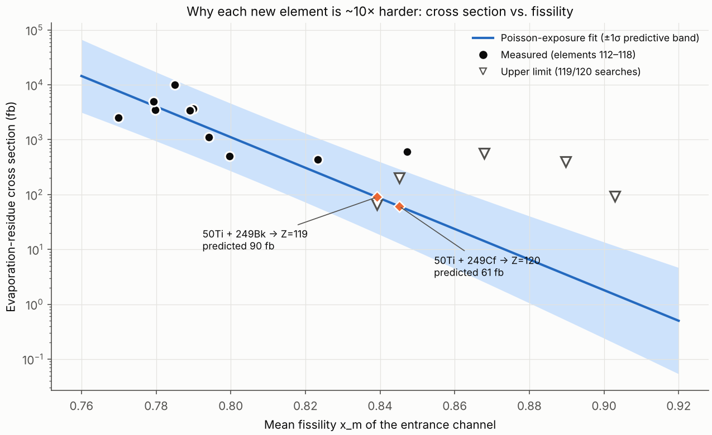
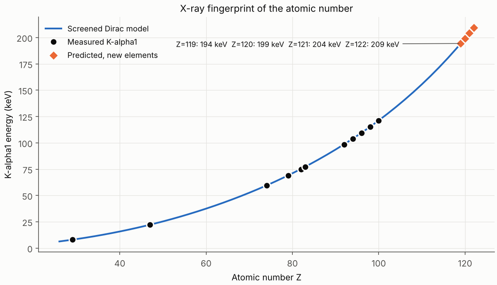
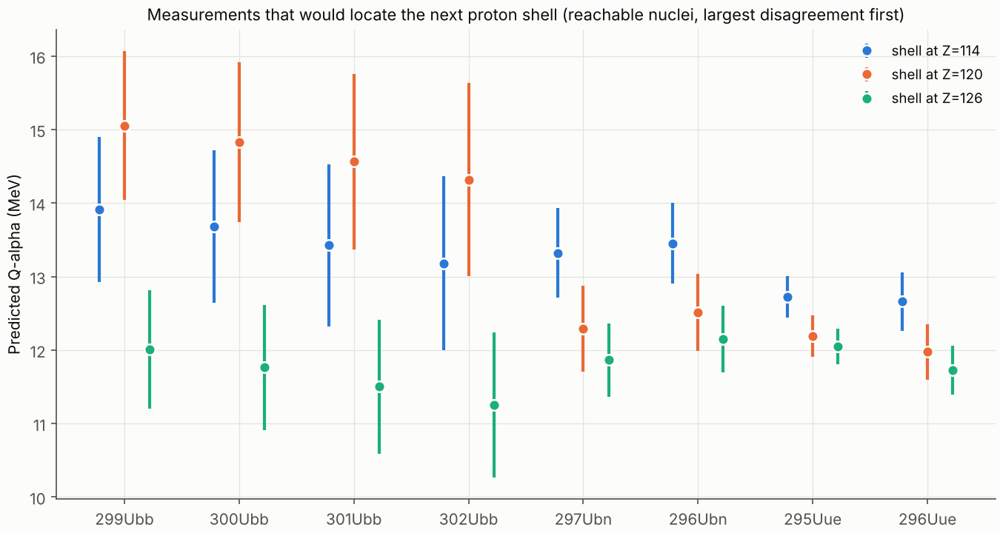

# Elemental Discovery: where new elements may exist, and how we would know

_Generated by `python -m elemental_discovery report`. Every number below comes from models calibrated in this package on measured data (see `elemental_discovery/data.py`). Uncertainties are 1σ; half-life uncertainties are in decades (log10 s)._

## 1. How good is the model where we can check it?

| Component | Calibrated on | Scatter |
|---|---|---|
| Mass model, shell at Z=114 | 25 binding energies + 47 Q-alpha | B: 0.89 MeV, Q-alpha (global): 0.79 MeV |
| Mass model, shell at Z=120 | 25 binding energies + 47 Q-alpha | B: 1.17 MeV, Q-alpha (global): 0.68 MeV |
| Mass model, shell at Z=126 | 25 binding energies + 47 Q-alpha | B: 0.88 MeV, Q-alpha (global): 0.67 MeV |
| Alpha half-life (universal decay law, 3 parameters) | 47 alpha emitters | 0.45 decades (leave-one-out 0.48) |
| Fission half-life, Z=114 | 15 SF emitters | 2.1 decades (leave-one-out 2.5) |
| Fission half-life, Z=120 | 15 SF emitters | 2.0 decades (leave-one-out 2.4) |
| Fission half-life, Z=126 | 15 SF emitters | 2.1 decades (leave-one-out 2.5) |
| Fusion cross section | 10 measured + 5 zero-event searches (Poisson likelihood) | ×3.7 |
| K-alpha1 X-ray energy (Dirac, finite nucleus) | 11 elements | 0.33 % |

A Gaussian-process correction trained on the Q-alpha residuals pulls predictions onto the data near measured nuclei; far from data it relaxes to the global model. A stationary GP's error stops growing at its amplitude, so a term proportional to the distance from the nearest measured nucleus is added in quadrature, with its slope calibrated on forward tests (next section). Every other law reports its regression *predictive* standard deviation, which also grows as it extrapolates.

### Out-of-sample checks: fit the past, predict the future

Discovery history provides the test: fit on everything lighter than a cut in Z, predict everything heavier, and compare the errors with the claimed error bars. A calibrated model has forward z-scores with rms ≈ 1.

| Alpha half-life law | Parameters | In sample | Leave-one-out | Forward, fit Z<100 | Forward, fit Z<104 | Forward, fit Z<110 | Forward, fit Z<112 |
|---|---|---|---|---|---|---|---|
| Viola–Seaborg | 6 | 0.36 | 0.45 | 0.70 | 1.41 | 0.58 | 0.66 |
| Universal decay law (WKB) | 3 | 0.45 | 0.48 | 0.74 | 0.53 | 0.49 | 0.63 |

Errors are in decades. The three-parameter WKB law describes the data as well as the six-parameter Viola–Seaborg form and extrapolates up to three times better, so it is now the alpha law used throughout.

| Mass model | Forward Q-alpha rms (MeV) | Forward bias (MeV) | z-rms, GP error only | z-rms, calibrated | Error growth k (MeV per unit Z–N distance) |
|---|---|---|---|---|---|
| Z=114 | 1.48 | -0.82 | 2.6 | 1.07 | 0.154 |
| Z=120 | 1.82 | -1.61 | 3.4 | 1.02 | 0.208 |
| Z=126 | 1.23 | -0.49 | 2.5 | 1.09 | 0.139 |

The GP's own error bars were 2.5–3.5× too small out of sample. With the distance term they are calibrated (z-rms ≈ 1).

| Fission law | Shell slope k, data only | k with explicit prior N(2.25, 0.75²) | Shell energies in calibration set (MeV) | Leave-one-out (decades) |
|---|---|---|---|---|
| Z=114 | +0.16 ± 1.00 | 1.54 ± 0.61 | -4.7 to -0.8 | 2.5 |
| Z=120 | +0.27 ± 1.75 | 1.94 ± 0.69 | -2.3 to 0.0 | 2.4 |
| Z=126 | -0.84 ± 1.62 | 1.76 ± 0.69 | -2.1 to 0.1 | 2.5 |

Fitted freely, the fission data show no measurable stabilisation by shell energy: k is consistent with zero. The calibration nuclei have small shell energies, and the island (−7 to −11 MeV) lies far outside them. The shell slope is therefore a physics *prior*, now stated explicitly. Its consequence is visible in the predictive uncertainty:

| Nucleus | log10 T_SF, Z=114 (±1σ) | log10 T_SF, Z=120 (±1σ) | log10 T_SF, Z=126 (±1σ) |
|---|---|---|---|
| 298Fl | 11.4 ± 5.9 | 13.9 ± 6.2 | 6.7 ± 4.2 |
| 296Nh | 16.3 ± 6.3 | 17.9 ± 6.3 | 11.0 ± 4.8 |
| 296Ubn | -1.7 ± 2.9 | 9.4 ± 4.8 | 2.2 ± 3.0 |
| 298Ubn | -0.0 ± 2.9 | 11.7 ± 5.5 | 4.0 ± 3.4 |
| 302Ubb | 0.5 ± 2.9 | 12.0 ± 5.6 | 7.7 ± 4.5 |

Fission half-lives on the island are uncertain by many decades. The island's location follows from the shell prior; its lifetime is not determined by the fission data.

## 2. Where is the next magic proton number?

Theory disagrees: macroscopic–microscopic models favour **Z = 114**, many relativistic mean-field models **Z = 120**, some Skyrme models **Z = 126**. The model is fitted once per hypothesis and each version is scored on the superheavy data. The global model (before the data-driven correction) is what controls extrapolation, so that is what gets scored.

| Hypothesis | Q-alpha rms, Z ≥ 104, in sample (MeV) | Forward-test rms (MeV) | Forward log-likelihood | Weight | observed decay modes reproduced |
|---|---|---|---|---|---|
| Z=114 | 0.85 | 1.48 | -119.6 | 0.18 | 10/10 |
| Z=120 | 0.56 | 1.82 | -129.6 | 0.02 | 9/10 |
| Z=126 | 0.86 | 1.23 | -112.7 | 0.80 | 5/10 |

In sample, Z=120 fits the superheavy data best. Asked to *predict* heavier nuclei before seeing them, Z=126 does best and the ranking reverses: in-sample fit is not evidence about extrapolation. The weights come from the forward log-likelihood, tempered because nested cuts reuse nuclei. They are used to average discovery probabilities (section 6); per-hypothesis results are always shown as well.

## 3. The island of stability



| Hypothesis | Longest-lived predicted nucleus (Z ≥ 110) | Half-life | ±1σ (decades) | Mode |
|---|---|---|---|---|
| Z=114 | 295Cn (Z=112, N=183) | ~1.06e+05 yr | 6.7 | alpha |
| Z=120 | 294Ds (Z=110, N=184) | ~4.24e+06 yr | 6.7 | SF |
| Z=126 | 297Nh (Z=113, N=184) | ~49.6 yr | 4.8 | SF |

Every hypothesis puts the longest lifetimes at **N = 183–184**, 6–7 neutrons beyond the most neutron-rich superheavy nucleus made so far (N = 177). Fusion of stable beams with actinide targets cannot reach that far: the compound nuclei are too neutron-poor. That neutron deficit, not the element count, is the real frontier. Even with the proton shell placed at 120 or 126, the longest lifetimes sit at Z ≈ 110–113, because Coulomb repulsion grows faster than the shell gain. The *location* (N ≈ 184) is robust across hypotheses. The *lifetimes* are not: they carry several decades of uncertainty, set mostly by the fission shell-slope prior (section 1).

## 4. Could any of this exist in nature?

| Environment | Age scale | Half-life needed for 10⁻¹⁵ survival | Longest predicted half-life | Shortfall (decades) | P(long enough) |
|---|---|---|---|---|---|
| Kilonova ejecta (neutron-star merger), days after | 10 d | ≳ 4.82 h | 4.24e+06 yr | 0.0 | 0.93 |
| Galactic cosmic rays (confinement time) | 1.5e+07 yr | ≳ 3.01e+05 yr | 4.24e+06 yr | 0.0 | 0.57 |
| Earth's crust / meteorites (age of the Solar System) | 4.57 Gyr | ≳ 9.16e+07 yr | 4.24e+06 yr | 1.3 | 0.42 |

The longest-lived candidate is 294Ds (shell at Z=120), uncertain by ±6.7 decades. Kilonova ejecta: passes on the central estimate (P = 0.93). Galactic cosmic rays: passes on the central estimate (P = 0.57). Earth's crust / meteorites: falls 1.3 decades short (P = 0.42). Probabilities this far from the calibration data are only as good as the shell prior. With honest error bars the model **cannot rule out** long-lived superheavy nuclei on theoretical grounds alone: the case against primordial survival is the null result of decades of terrestrial and meteoritic searches, not nuclear theory. The island's own uncertainty is the largest gap in our knowledge. Kilonova spectra (r-process in neutron-star mergers) remain the most direct natural probe, although fission recycling near A ≈ 280–300 limits how far the r-process reaches.

## 5. Making elements 119–122



Assumptions: 6 pµA beam, 0.5 mg/cm² target (254Es: 0.001 mg/cm², since only micrograms exist), 50 % separator efficiency, 1 µs flight time through the separator. Cross sections are uncertain by a factor of ~3.7.

Cross sections here are the fit's central values *before* conditioning each reaction on its own null search, and beam days are point estimates. Section 6 replaces both with probabilities.

| Z | Reaction | Residue | E* (MeV) | σ (fb) | Half-life (1σ decades) | Reach detector | Beam days for 3 chains (90 %) | Chain ends |
|---|---|---|---|---|---|---|---|---|
| 119 | 48Ca + 254Es | 298Uue | 33 | 883 | 150 µs (±1.8) | 86 % | 1825 | reaches known nucleus 294Ts |
| 119 | 50Ti + 249Bk | 296Uue | 32 | 90 | 23 µs (±1.0) | 87 % | 35 | reaches known nucleus 288Mc |
| 119 | 51V + 248Cm | 295Uue | 35 | 32 | 17.4 µs (±0.8) | 89 % | 96 | reaches known nucleus 287Mc |
| 120 | 50Ti + 251Cf | 298Ubn | 32 | 65 | 6.2 µs (±1.6) | 66 % | 64 | reaches known nucleus 294Og |
| 120 | 50Ti + 249Cf | 296Ubn | 29 | 61 | 1.21 µs (±1.2) | 50 % | 88 | reaches known nucleus 288Lv |
| 120 | 51V + 249Bk | 297Ubn | 32 | 22 | 2.11 µs (±1.3) | 57 % | 216 | reaches known nucleus 293Og |
| 121 | 50Ti + 254Es | 301Ubu | 32 | 48 | 29 µs (±2.3) | 72 % | 40454 | reaches known nucleus 293Ts |
| 121 | 51V + 251Cf | 299Ubu | 32 | 16 | 2.22 µs (±1.8) | 56 % | 313 | reaches known nucleus 287Mc |
| 121 | 51V + 249Cf | 297Ubu | 29 | 15 | 373 ns (±1.5) | 38 % | 485 | reaches known nucleus 281Nh |
| 122 | 51V + 254Es | 302Ubb | 32 | 12 | 13.2 µs (±2.4) | 66 % | 183028 | reaches known nucleus 294Og |
| 122 | 54Cr + 251Cf | 302Ubb | 31 | 7 | 13.2 µs (±2.4) | 66 % | 599 | reaches known nucleus 294Og |
| 122 | 54Cr + 249Cf | 300Ubb | 28 | 7 | 1.49 µs (±2.0) | 52 % | 799 | reaches known nucleus 288Lv |

**A hidden obstacle:** the predicted half-lives of element 120–122 isotopes are close to the ~1 µs it takes a recoil to cross the separator. If they are at the short end of the error band, most atoms decay in flight and are never seen. That is a separate route to a null result, unrelated to the cross section. Fast digital electronics, which catch decays within microseconds of implantation, and short separators help here.

Check against published non-observations:

Each search is left out of the fit in turn, and the refitted model is asked how probable *zero* events were at that search's exposure (exposure = ln 10 / 90 %-CL limit).

| Search | Predicted (median) | Published upper limit | P(0 events) | Equivalent tension |
|---|---|---|---|---|
| 50Ti+249Bk -> 119 (GSI/TASCA) | 160 fb | 65 fb | 0.09 | 1.4σ |
| 50Ti+249Cf -> 120 (GSI/TASCA) | 83 fb | 200 fb | 0.39 | 0.3σ |
| 54Cr+248Cm -> 120 (GSI/SHIP) | 16 fb | 560 fb | 0.85 | none |
| 58Fe+244Pu -> 120 (Dubna) | 4 fb | 400 fb | 0.92 | none |
| 64Ni+238U -> 120 (GSI/SHIP) | 2 fb | 94 fb | 0.86 | none |

The most constraining null result is 50Ti+249Bk -> 119 (GSI/TASCA): a model that has not seen it gives zero events a probability of 0.09 (1.4σ). Either Ti-induced cross sections fall faster than the fissility trend or that search was unlucky; the fit and section 6 condition on it either way.

## 6. How likely is a discovery? (the discovery calculus)

Point estimates of "beam days" are biased in the optimistic direction. The cross section is log-normal, so its mean exceeds its median. The half-life is uncertain, so the fraction of atoms that survive the flight is lower than at the central value. And under the IUPAC criteria a chain counts only if it is anchored to known nuclei. The calculus carries all three into one number:

```
P_disc(D) = P_anchor · E_{σ,T}[ P_Poisson(≥ k ; λ(σ,T)·D) ]
λ        = σ · I_beam · n_target · ε · 2^(−t_flight/T)
P_anchor = Π_unknown links Φ( (log T_SF − log T_α) / √(sd_SF² + sd_α²) )
```

log σ has the posterior predictive distribution of the cross-section law, conditioned on any zero-event exposure already spent on that reaction. log T is normal with the decay laws' predictive sd. The expectation is evaluated by Gauss–Hermite quadrature.

Campaign: 300 beam days, k = 3 anchored chains, 6 pµA, 50% efficiency, 1 µs flight.

| Z | Reaction | Residue | σ median (fb) | Already searched? | Survive flight (Z=114) | P_anchor 114/120/126 | P_disc 114/120/126 | P_disc, weighted | Days to 50 % (Z=114) |
|---|---|---|---|---|---|---|---|---|---|
| 119 | 48Ca + 254Es | 298Uue | 883 | no | 86% | 0.98/0.00/0.84 | 0.23/0.00/0.22 | **0.22** | 964 |
| 119 | 50Ti + 249Bk | 296Uue | 23 | yes, 0 events | 87% | 0.93/0.99/0.85 | 0.78/0.87/0.75 | **0.76** | 82 |
| 119 | 51V + 248Cm | 295Uue | 34 | no | 89% | 0.81/0.99/0.85 | 0.69/0.87/0.75 | **0.74** | 73 |
| 120 | 50Ti + 251Cf | 298Ubn | 70 | no | 66% | 0.93/0.98/0.98 | 0.70/0.91/0.92 | **0.88** | 50 |
| 120 | 50Ti + 249Cf | 296Ubn | 30 | yes, 0 events | 50% | 0.54/0.98/0.72 | 0.32/0.86/0.65 | **0.60** | never |
| 120 | 51V + 249Bk | 297Ubn | 24 | no | 57% | 0.98/0.98/0.72 | 0.58/0.79/0.60 | **0.60** | 173 |
| 121 | 50Ti + 254Es | 301Ubu | 52 | no | 72% | 0.95/0.97/0.80 | 0.01/0.01/0.01 | **0.01** | 28309 |
| 121 | 51V + 251Cf | 299Ubu | 17 | no | 56% | 0.79/0.99/0.89 | 0.39/0.50/0.69 | **0.63** | 1496 |
| 121 | 51V + 249Cf | 297Ubu | 16 | no | 38% | 0.64/0.79/0.57 | 0.23/0.28/0.43 | **0.39** | never |
| 122 | 51V + 254Es | 302Ubb | 13 | no | 66% | 0.83/0.99/0.82 | 0.00/0.00/0.00 | **0.00** | 295801 |
| 122 | 54Cr + 251Cf | 302Ubb | 8 | no | 66% | 0.83/0.98/0.82 | 0.36/0.22/0.50 | **0.47** | 1003 |
| 122 | 54Cr + 249Cf | 300Ubb | 7 | no | 52% | 0.48/0.98/0.63 | 0.17/0.12/0.38 | **0.34** | never |

Best route per element, by the weighted discovery probability in one campaign: Z=119: 50Ti + 249Bk (76%); Z=120: 50Ti + 251Cf (88%); Z=121: 51V + 251Cf (63%); Z=122: 54Cr + 251Cf (47%).

"Never" means that even unlimited beam time cannot reach 50 %: with the probability left after flight losses and the chance that the chain fails to anchor, discovery stays below even odds. Reactions already searched without success are penalised exactly once, through their own exposure. Einsteinium routes are limited by the target, not the physics.

## 7. How a discovery would be confirmed

Worked example: **296Ubn** from 50Ti + 249Cf (3n), shell at Z=114.

| Step | Mode | E_alpha (MeV) | Half-life | K-alpha1 (keV) | Known? |
|---|---|---|---|---|---|
| 296Ubn | alpha | 13.27 ± 0.55 | 1.21 µs (±1.2) | 199.2 | new |
| 292Og | alpha | 11.49 ± 0.46 | 1.89 ms (±1.1) | 189.6 | new |
| 288Lv | alpha | 11.48 ± 0.36 | 565 µs (±0.9) | 180.4 | yes |

* Reaches known nucleus 288Lv.
* Expected random look-alike chains over a 100-day run: 1.1e-20. Three real chains would be a result far beyond 5σ on counting statistics alone.
* K X-rays of Z=120: 199.2 keV (+/-0.7); neighbour Z=119 differs by 4.9 keV
* A/q mass measurement of the recoil (FIONA-type) to fix A
* Excitation function: maximum near E* = 30-40 MeV for 3n/4n confirms the channel
* Predicted half-life 1.2 us is comparable to the ~1 us separator flight time: digital electronics are needed to catch decays within microseconds of implantation, and many atoms will decay in flight

IUPAC/IUPAP discovery criteria (Joint Working Group, 2018) that a claim must meet:

1. Z must be established beyond reasonable doubt; A is desirable but not required.
1. Genetic correlation of the decay chain to previously known nuclei is the strongest evidence; chains that end in fission must be supported by cross-bombardments, excitation functions or independent Z identification.
1. Random-correlation probability must be shown to be negligible.
1. Results must be reproduced, preferably by an independent laboratory and/or a different reaction.
1. Energy calibration, separator transmission and detector response must be documented so that independent reviewers can assess the claim.



### Measurements that discriminate between shell hypotheses



| Nucleus | Q-alpha, Z=114 | Q-alpha, Z=120 | Q-alpha, Z=126 | Model σ | Spread / σ |
|---|---|---|---|---|---|
| 299Ubb | 13.91 | 15.05 | 12.01 | 0.94 | 3.3 |
| 300Ubb | 13.68 | 14.83 | 11.76 | 0.99 | 3.1 |
| 301Ubb | 13.43 | 14.56 | 11.50 | 1.07 | 2.9 |
| 302Ubb | 13.18 | 14.32 | 11.25 | 1.16 | 2.6 |
| 297Ubn | 13.32 | 12.29 | 11.86 | 0.57 | 2.6 |
| 296Ubn | 13.45 | 12.51 | 12.15 | 0.51 | 2.6 |
| 295Uue | 12.73 | 12.19 | 12.05 | 0.27 | 2.5 |
| 296Uue | 12.66 | 11.97 | 11.73 | 0.37 | 2.5 |

The most discriminating reachable nucleus is 299Ubb: the hypotheses differ by 3.0 MeV in Q-alpha, 3.3× the calibrated model uncertainty. With the error bars calibrated by forward tests (they grow with distance from data), one measured chain narrows the field but no single chain settles it.

## 8. Where does the periodic table end?

* **Nuclear limit.** For Z ≥ 125, the longest-lived isotopes with N ≤ 185 (the most fusion could conceivably reach) are Z=114: 309Ubp, 20.5 µs; Z=120: 309Ubp, 126 ns; Z=126: 309Ubp, 389 ms. Longer lifetimes appear only far out on the neutron-rich side (N > 200), which no known production route can reach. There the fission barrier is pure shell effect.
* **Atomic limit.** Solving the Dirac equation for a finite nucleus puts the 1s level below −mc² at **Z_cr ≈ 170** (bare ion; screening and nuclear-radius choices move this within ~170–173). Beyond it the vacuum itself would decay by emitting positrons. The point-nucleus Dirac formula fails earlier, at Z = 137.
* **Chemical limit.** Inner electrons move at v/c ≈ Zα (0.87 for Z = 119), so relativity reorders the orbitals and the Madelung rule breaks down from Z ≈ 121.

| Z | Symbol | Madelung configuration (tail) | Relativistic prediction | Note |
|---|---|---|---|---|
| 119 | Uue | … 6d10 7p6 8s1 | [Og] 8s1 | 8s strongly contracted: IE higher than Fr/Cs, chemistry closer to K/Rb |
| 120 | Ubn | … 6d10 7p6 8s2 | [Og] 8s2 | expected to resemble Ca/Sr more than Ra |
| 121 | Ubu | … 7p6 8s2 5g1 | [Og] 8s2 8p1/2^1 | relativistically stabilised 8p1/2 fills before 5g (Madelung would say 5g1) |
| 122 | Ubb | … 7p6 8s2 5g2 | [Og] 7d1 8s2 8p1/2^1 | 7d, 6f, 5g and 8p1/2 lie within ~1 eV: configuration mixing, ill-defined 'block' |

## 9. Limitations

* The mass model is spherical Myers–Swiatecki shell structure plus a deformation term. It does not resolve the deformed sub-shells at N = 152/162, which the Gaussian-process correction absorbs only near data.
* Fission half-lives are uncertain by about 2.5 decades even where calibrated (leave-one-out), and by far more on the island, where the shell slope rests on an explicit prior that the data cannot test. Weak-decay (EC/β) half-lives are order-of-magnitude estimates.
* The discovery calculus neglects correlations between the residue's half-life and the anchoring probability (both depend on the same Q-alpha), and picks one evaporation channel per reaction.
* Cross sections use one-parameter fissility systematics. Real reaction dynamics (quasi-fission, deformation of the target, beam energy choice) can shift them by factors of several.
* Reference data were compiled by hand and rounded. Check them against AME2020/NUBASE2020 before quoting any number.
